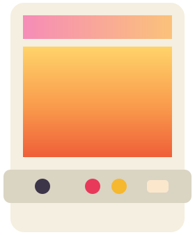
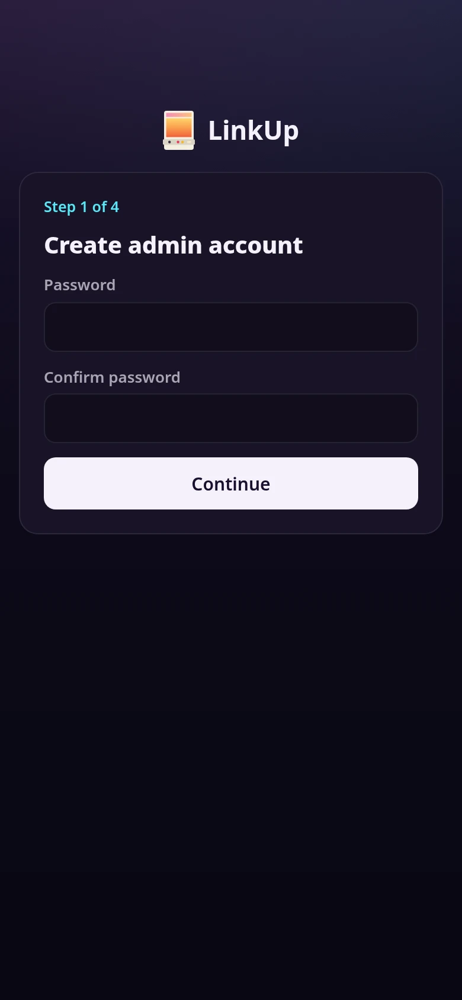
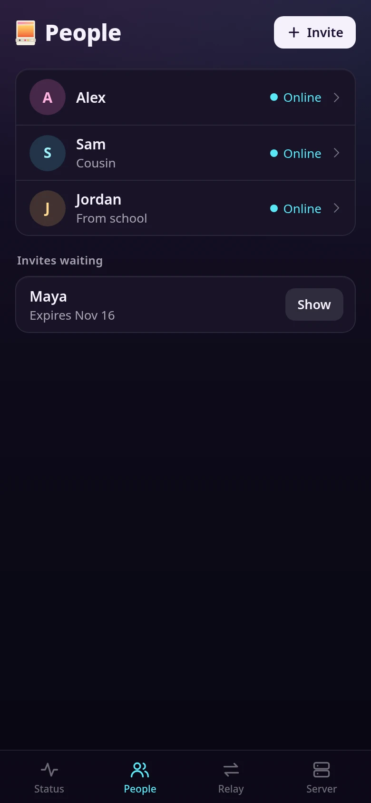
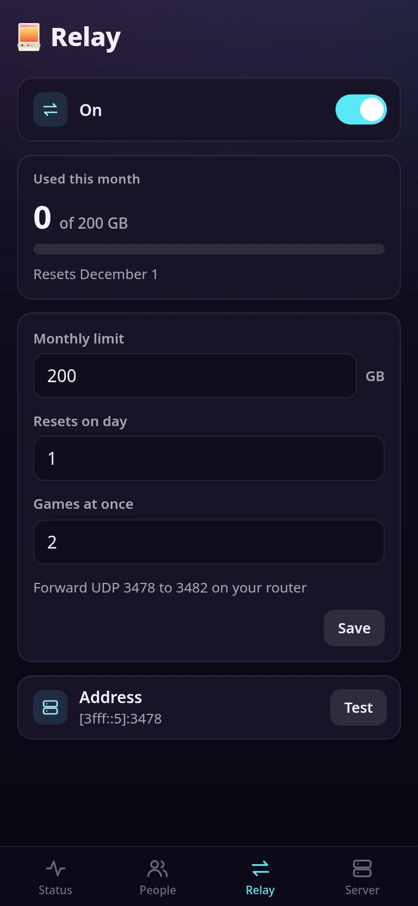
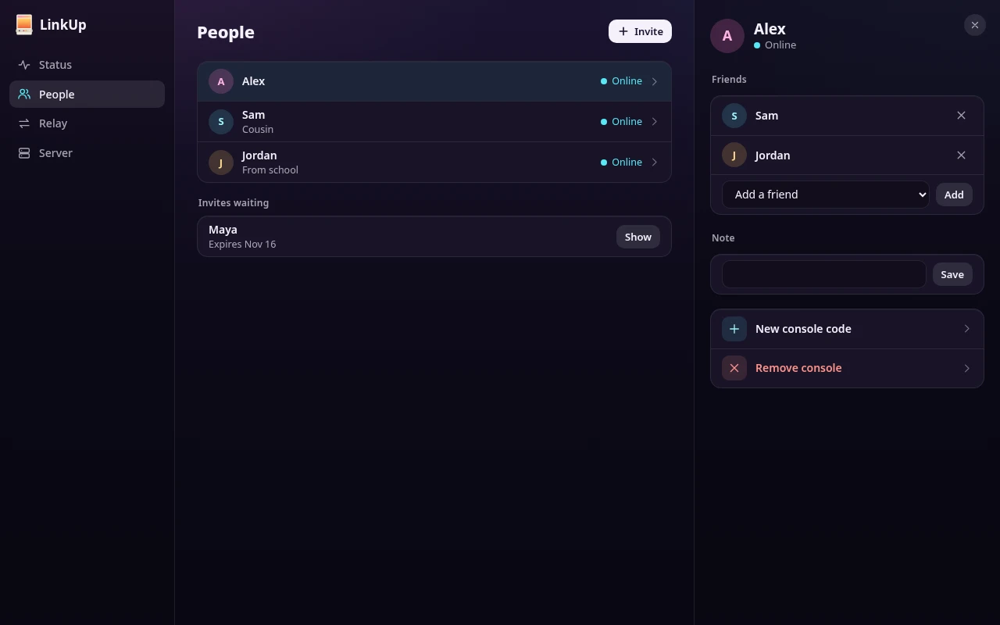

<p align="center"></p>

# cabinet-linkup

**LinkUp: "Player two, from anywhere."** The self-run server behind LinkUp on
[CabinetOS](https://github.com/MMagTech/cabinetos). One console hosts a game and streams it, a
friend's console joins from their house as player two, and only the host needs the game.

The project runs no service. Each owner runs their own copy of this small container for the
people they know. It introduces consoles to each other and offers a relay for games with no other
way through. Games normally go straight between the two consoles and never touch it.

**This is hobby software, and you run it at your own risk.** Nobody is paid to look after it and
nobody can promise it has no holes. Keep it up to date, and read [What it holds](#what-it-holds).

| | | |
|---|---|---|
|  |  |  |



Playing happens on the console. The player's guide is
[LinkUp on CabinetOS's wiki](https://cabinetos.mmagtech.com/wiki/linkup.html).

## What you need

- Docker, Podman or Unraid, on anything from a Raspberry Pi up.
- A way for the internet to reach one TCP port: a port forwarded on your router, or a VPS.
- A fixed address or a dynamic DNS name. Without one, everyone has to retype the address each time
  your home address changes.

## Running it

**At home, with Docker:** copy [compose.yaml](compose.yaml) next to an empty folder called `data`.

```bash
mkdir data && sudo chown 1000:1000 data
docker compose up -d
```

**On a VPS:** the same, with [compose.vps.yaml](compose.vps.yaml). It publishes the admin page only
to the VPS itself, because Docker opens a published port to the whole internet, even past a firewall
you have set up. Reach the page through an SSH tunnel, which needs nothing new installed:

```bash
ssh -L 7846:127.0.0.1:7846 you@your-vps
```

Then open `http://localhost:7846` on your own machine. Tailscale on the VPS works too, if you want to
reach the page from a phone. It is the one way of reaching it from outside that the page allows,
because it counts 100.64.0.0/10 as not public.

**On Unraid:** make the data folder first, owned by the user Unraid runs containers as, or the server
stops with "the data folder cannot be written". Then fetch the template,
[unraid/cabinet-linkup.xml](unraid/cabinet-linkup.xml). Both in Unraid's terminal:

```bash
mkdir -p /mnt/user/appdata/cabinet-linkup && chown 99:100 /mnt/user/appdata/cabinet-linkup
curl -fsSL -o /boot/config/plugins/dockerMan/templates-user/my-cabinet-linkup.xml https://raw.githubusercontent.com/MMagTech/cabinet-linkup/main/unraid/cabinet-linkup.xml
```

Then on the Docker page: Add Container, Template, cabinet-linkup, and fill in the fields.

**Rootless Podman:** use `--network=host` and set the ports with the variables below. A rootless
container's own network hides visitors' addresses, which the relay needs, and hides other containers on
the same machine.

Then open the admin page, `http://your-server:7846`. **Whoever opens it first sets the password,**
so do that as soon as it is running. Until then it opens only by an address, such as
`http://192.168.1.50:7846`, or by a name with no dots or one ending in `.local`, `.lan` or `.home.arpa`.
A web page anyone at home has open could point a name of its own at your server and set the password
before you, and a name like that is what it would use.

### Ports

| Port | What it is | Forward it? |
|---|---|---|
| 7845/tcp | Consoles and linked servers | Yes |
| 7846/tcp | The admin page | **Never** |
| 3478 to 3510/udp | The relay, and its games' ports after it | Only if the relay is on, and only as far as its Relay tab says |

The admin page refuses a visitor it can see is outside your home, but Docker hides the address of one
who arrives over IPv6: the page sees Docker's own. So [compose.yaml](compose.yaml) publishes it on IPv4
only. If you start the container another way and the server has a public IPv6 address, keep 7846 closed
to IPv6 on your router, as most routers do unless told otherwise.

Any port outside the container can lead to the console port and the admin page. The relay's ports must
be the same outside as inside, because the relay tells consoles its own port numbers. To move them, set
`LINKUP_RELAY_PORT` and map the same range on both sides: `13478-13510:13478-13510/udp` for 13478.

## First run

1. **Create admin account:** the password.
2. **This server:** a short name, which friends may see beside a username, and its public address.
3. **Relay:** turn it on with a monthly limit, or skip it.
4. **Your console:** the server's local address, for the console in your own house. It gives you a
   code. On that console: Settings, Streaming, turn on LinkUp, then Server, Add a server.

If you walk away at any step, sign in again and you come back to the first one you have not finished.

### Which address to enter

Both are free text. The server only hands them out in messages, and never connects to them for a
first run, so a mistake here shows up when someone tries to use it.

| How you run it | Public address | Local address |
|---|---|---|
| At home, dynamic DNS | `your.dynamic.name:7845` | `192.168.1.50:7845`, your server on your own network |
| At home, a fixed IP | `203.0.113.5:7845` | `192.168.1.50:7845` |
| A VPS | `your.vps.name:7845` or its IP | The same as the public one: a VPS has no local network |
| A reverse proxy | `linkup.example.net`, with no port, or `https://linkup.example.net` | As for your setup |
| IPv6 | `[2001:db8::1]:7845`, in brackets | As for your setup |
| Your own VPN, by your choice | The VPN's name or address | The same, and skip the relay |

The console in your own house uses the local address because routers vary on looping back. You can
change either address later; friends retype the new one in Settings with no new code. Linked servers
hear of a new public address on their own.

A reverse proxy covers the console port only. It adds nothing to the protocol's safety, and needs no
trusted certificate: every message is already sealed. The relay's UDP ports are always forwarded
separately, and the relay finds its own address without asking the proxy. Never put the admin page
behind a proxy that faces the internet; the page refuses a visitor it can see is outside, but a proxy
can hide that.

With Traefik's Docker provider, tell it which port, because the container offers two: the label
`traefik.http.services.cabinet-linkup.loadbalancer.server.port=7845`. 7846 is the admin page and is
never routed.

Nothing is built or promised for any VPN, and none of it has been tried. Any network works if the two
consoles can reach each other. A VPN asks every friend for an account and setup, where everything
else asks only you.

## People

**Inviting a friend:** People, Invite. Pick whose friend it is for, and Copy the message. It has your
address, a code and the day it expires. Send it however you like; the server sends nothing. The person
types both on their console, and **the account signed in at that moment becomes the friend**. If that
was the wrong account, you do not need a new code: on People, remove the friend from that account, add
the right one once it has signed in on that console, and move your note. If it is the very account the
invite was for, that console joins them instead, as their own code does.

An invite stops after 7 days if nobody uses it. Whoever uses it first takes the place, and from then
on it works only for them, so if a stranger ever uses one you will see their username on People, and
can remove them.

**A friend with no console** types the invite into
[2P Start](https://github.com/MMagTech/cabinet-linkup-guest), an app for a Mac or a Windows PC that
joins a game and never hosts one. The name they type there is the username you see, with 2P Start
under it. Two 2P Start people could never play each other, so People does not offer them to each other
as friends, and Invite's whose friend lists only people with a console.

**A second account on a console** appears on People the first time it signs in, with no friends. Add
friends on its page.

**Only you make friends.** Two people on your server are friends only if you add them. A child's
account sees only its own friends, and those friends see nobody else.

**Each person's own code** is the invite they used: the same letters, shown again under Their code
on their page. It works on every console signed in as them, as often as they need, and lasts until
you change it. An invite nobody has used still stops after 7 days. They are one person on all of those consoles,
shown once on People, with the same friends, and a console added this way also knows anyone already
on their other consoles. A game invite rings the console they used last, and Offline chosen on one
holds on all of them. Their page lists their consoles, with when each was added and last used.

**A reinstall:** type that person's code on the console again, and they are back with their friends.
The console as it was before stays on their list, with its old last used day, until you change their
code.

**Change code,** on their code, if it got out or a console was sold: they are signed out of every
console, keep their friends, and type the new code on the consoles they still have. Anyone else on
those consoles comes back with it.

**Remove,** on their page, takes them off with their friends, and signs out every console they are on.

**Someone who shows twice,** because their second console was paired before consoles joined up: on
the second one's page, Remove. Then type the first one's code on that console.

## Linked servers

Linking connects **chosen pairs of people, not whole servers.** If you and a friend each run a server,
you link them and pick who can see whom. Everyone else on each server stays on that server, and neither
owner ever sees the other's list. There is no chain to a third server.

On your admin page: Server, Linked servers, Create code. Pick an account and send the message. The other
owner enters your address and the code on their own page and picks an account: those two people are now
friends. More pairs can join the same link the same way, and either owner can remove a pair or the whole
link. Consoles change nothing. Each server needs someone on it before you link.

If your server is off, your people reach nobody, and friends on a linked server see them as Offline. A
link needs each server to reach the other, since an invite travels from the inviter's server to the
friend's. While yours can't reach theirs, the link shows Can't reach on your admin page and their people
show as Offline, even if theirs still reaches yours.

## The relay

Some connections have no other way through. The relay is built into this container: there is nothing to
buy and no account anywhere. It is off until you turn it on.

**What it costs you:** every relayed game uses your own upload, up to about 18 Mbit/s, which is 1.9 to
8.1 GB an hour. Most games go direct and cost you nothing. On a home connection, two relayed games at once
may be all your upload can carry.

**Games at once,** on the Relay tab, is how many relayed games can run at the same time: 2 at first, up
to 16. Each takes up to two ports, one for each console, right after 3478, so the tab gives the one line
to forward on your router: "Forward UDP 3478 to 3482 on your router" for two. The container maps the ports
for 16, so raising the number needs no new container, only a wider forward. The relay never opens a port
past your number, and opens one only while a game is using it. Forward the whole range, not only 3478:
with only 3478 forwarded, Test passes but games through the relay cannot connect.

**Its address** is where the STUN list sees the server's packets come from, the way a console finds its
own. A reverse proxy, or a service like Cloudflare in front of one, does not change that, so your public
address can be a name that leads to one.

**The monthly limit** counts data through the relay. At the limit the relay stops until the day you set
as its reset day (a day past the end of a month means its last day), and direct games keep working. A VPS
is billed on its own day, so set that. The limit does not slow anything down before then. It is your only
control: there is no daily limit, and a game's own bitrate is capped by the relay at about what the
console's stream reaches at its peaks.

**When you would leave it off:** your friends all connect directly, or your upload is too small, or you
would rather not carry anyone's games.

**Behind carrier-grade NAT,** forwarding a port does not work at all, so the answer is a VPS with the relay
on. That is the only place paying for anything comes in, and it is your choice. A custom STUN address
does not help: STUN only tells a console its outside address, and carries nothing.

**Test** checks only 3478/udp, not the games' ports after it, so it can pass while games through the relay
still fail. If one can't connect, check that your router forwards the whole range the Relay tab gives.
Test can also fail wrongly if your router cannot loop back to itself. A friend's game is the final answer.

The relay refuses to send to private addresses, so it cannot be used to reach into your home network. A
password is good for one game and is never given to anyone outside it. Packets stay encrypted between the
two consoles, so the relay cannot read them.

## What it holds

Everything is in the one data folder, outside the container.

| What | How it is kept |
|---|---|
| The server's private key | Readable by the container's user only. With it someone could pose as your server |
| Codes waiting to be used | Readable, because the page shows them again. Gone once used, cancelled or expired |
| The relay's secret | Readable by the container's user only |
| The admin password | A slow hash, in `admin.json` |
| Usernames, who is friends with whom, your notes, linked servers' addresses | Readable by the container's user only |
| Relay counts, the share of games that went direct, a small log | Plain counts |

It never holds RomM logins, games, saves, play history or email addresses, and it never writes a console's
internet address down. The folder is not encrypted on disk, because the server has to start by itself after
a reboot, and a key to unlock it would have to sit right beside it. So anyone with admin rights on that
machine, or access to a backup, can read it. **Keep the folder and its backups off network shares.**

Friends' internet addresses go between the two consoles in a direct game, which is how a direct connection
works, and is one more reason LinkUp is only for people you know.

**If it is ever stolen:** someone could see usernames, use up your relay's data, and send false connection
details to consoles. They could not reach anyone's RomM, because this server never holds a login. To recover,
delete the folder and start again. A restored copy would still have the stolen key.

### The log

It records the server starting and stopping, consoles paired or removed as numbers, links going up or down,
the relay turning on or reaching its limit, failed pairing attempts as counts, and how each game connected. It
never records codes, passwords, keys, internet addresses, usernames or game titles, so you can paste it into a
public issue. Server, Settings, Log has the last 200 lines and a download. It is capped at about a megabyte,
and updates leave it alone.

## Backing up and restoring

A backup is a copy of the data folder. People, friends, links, codes and settings are in one file, so
copying it while the server runs is safe. Unraid's appdata backup should cover this folder; that has not been
tried. A backup holds the server's key, so keep it private.

To restore, stop the container, put the folder back and start it. The server's key is in there, so consoles
stay paired. You lose what changed since the backup: a console paired after it needs its person's code again, and
friends added since are gone. Losing the folder with no backup means every console pairs again and every link
is redone. No game or save is ever at risk.

An older server refuses to start on a data folder from a newer one, rather than overwrite what it cannot read.

## Forgotten password

Stop the container, delete `admin.json` from the data folder and start it. The next person to open the admin
page sets a new password, so do that straight away. Nothing else is lost. Only a missing `admin.json` does
this: one that is damaged or cannot be read keeps the page locked until you delete it.

## Updating

```bash
docker compose pull && docker compose up -d
```

`:latest` is the release, and what the compose files and the Unraid template follow. `:testing` is for
trying what is next: it is built from every change before a release, so it can break, and going back is
changing the tag again. Copy the data folder before trying it.

The admin page tells you when a new version exists, by asking GitHub, and sends nothing about your server. An
update is never forced. Each image is signed, so you can check it came from this repository:

```bash
cosign verify ghcr.io/mmagtech/cabinet-linkup:latest \
  --certificate-identity-regexp '^https://github\.com/MMagTech/cabinet-linkup/' \
  --certificate-oidc-issuer https://token.actions.githubusercontent.com
```

## Settings when starting it

Most owners change none of these.

| Variable | Default | What it is |
|---|---|---|
| `LINKUP_DATA` | `/data` | The data folder |
| `LINKUP_CONSOLE_PORT` | `7845` | The console port |
| `LINKUP_ADMIN_PORT` | `7846` | The admin page's port |
| `LINKUP_RELAY_PORT` | `3478` | The relay's port. Its games use the 32 ports right after it |

0.1.0's `LINKUP_RELAY_PORTS` is no longer read: the games' ports follow the relay's own.

## For developers

[PROTOCOL.md](PROTOCOL.md) is the one definition of what consoles and servers say to each other,
[CONTRIBUTING.md](CONTRIBUTING.md) has the map of the code, and [SECURITY.md](SECURITY.md) is how to report a
hole privately. MIT licensed. Noto Sans, in the admin page, is under the
[Open Font Licence](https://openfontlicense.org).
